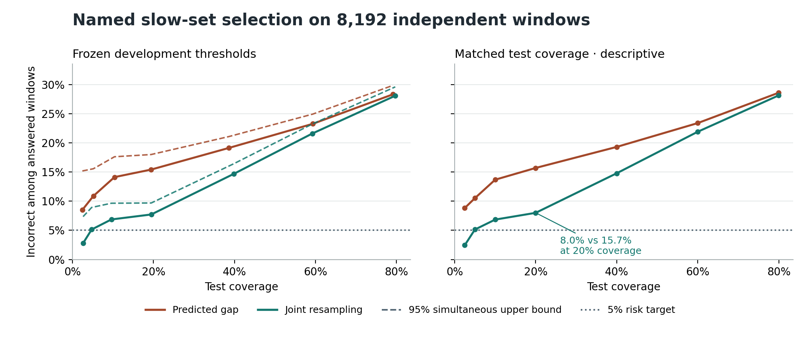

# 冻结 LeJEPA 的前瞻风险–覆盖验证

沿用四种 Gaussian AR(1) 条件和 16 个冻结 checkpoint。首次验证生成 64 套独立的解混校准、参考方差和命名扰动数据，开发与评价各 8,192 个窗口。开发集只读取预测分数。先封存同一名义 top-2 的预测、两条规则的阈值和代码哈希，再重放物理真值。目标用 \(V_j=1\) 及 lag 4、16、32 定义。两种规则输出同一个名义慢集，只改变哪些窗口作答。

[协议](PROTOCOL.md) · [阈值封存](THRESHOLD_LOCK.json) · [主评分](SCORE_SUMMARY.json)

## 首次前瞻结果

**两种规则达到预设风险上界的覆盖率均为 0。** 14 个固定规则都未达到已作答错选率上界 5% 的门槛。下表是两条规则观察错率最低的档位。

| 评分 | 作答覆盖 | 错选／作答 | 观察错率 | 同时 95% 单侧上界 |
| --- | ---: | ---: | ---: | ---: |
| 仅用预测间隔 | 2.44% | 17／200 | 8.50% | 15.17% |
| 联合重抽样评分 | 2.62% | 6／215 | 2.79% | 7.35% |

全量作答错选 2,796／8,192（34.13%）。在相同评价覆盖率下做描述性比较，联合评分在七个固定网格点的观察错率都较低。20% 覆盖时是 **131／1,638（8.00%）对 257／1,638（15.69%）**。最严格的联合规则，6 次错误都出现在谱交错条件，其中 5 个的真实窗口间隔大于 .03。该规则作答样本中窄间隔条件占 54／215，间隔规则为 93／200。因此汇总收益包含条件间筛选，条件内排序收益需独立判断。

同种子的四组正谱差模型，历史最弱轴线性 \(R^2\) 的绝对差仅 .000058–.000310。新窗口名义错选率的窄减宽差分别为 +12.91、+13.25、−3.76、+9.07 个百分点。进一步在这八个 checkpoint **各自内部**匹配约 20% 评价覆盖，联合评分在 6 个 checkpoint 错误更少，其余 2 个相同，合计错选从 54／826 降至 19／826。这是按评价分数排序的描述性结果。 [分组诊断](SCORE_DIAGNOSTICS.json) · [逐模型比较](MATCHED_CHECKPOINT.json)

## 新校准、新窗口复验

看完首轮后，单独选择预先冻结的两条最严格门槛做一次独立复验。保持原分数阈值和每套校准预算，生成另 64 套新校准及 32,768 个新评价窗口。复验前锁定两条规则，无阈值重估，两轮评价不合并。复验的置信上界仅对本轮两个冻结规则作同时校正。

| 评分 | 作答覆盖 | 错选／作答 | 观察错率 | 同时 95% 单侧上界 |
| --- | ---: | ---: | ---: | ---: |
| 仅用预测间隔 | 2.11% | 84／691 | 12.16% | 14.83% |
| 联合重抽样评分 | 2.48% | 33／813 | 4.06% | 5.65% |

联合规则在新校准和新窗口上再次获得较低的观察错率。两条规则的上界均超过 5%。联合规则的 33 个错误仍全部出现在谱交错条件，宽、窄间隔分别为 19／325、14／161。谱分离条件合计 0／327，这个分层是在评分后诊断，未对单独接受谱分离条件的规则做确认性检验。 [复验协议](replication/PROTOCOL.md) · [复验评分](replication/SCORE_SUMMARY.json)

## 失效定位

- 在同样的 20% 评价覆盖下，联合重抽样错 131 个，单独重抽解混和命名错 134 个，单独重抽参考轨迹错 256 个，仅用间隔错 257 个。单独重抽参考时有 80.18% 的窗口保持正的第 10 百分位间隔，重抽解混和命名时为 34.77%，联合为 32.59%。这些差异定位到当前重抽样对解混和命名的敏感性。
- 对同一批封存评价窗口重放点预测。校准轨迹从 128 增至 1,024，准确率由 65.87% 升至 70.64%。固定原解混与命名，把参考换成 32,768 个独立平稳状态，准确率升至 66.82%。直接按已知物理速率顺序给学习到的谱坐标命名，准确率降至 59.09%。当前最有效的单项替换是扩大无标签解混校准。它在谱交错且窄间隔时仅提升约 0.05 个百分点，剩余误差仍可能来自表示中的模态混合。以上是揭盲后的点误差诊断，结果用于确定后续要检验的假设。 [逐项替换](POINT_LOCALIZATION.md)

风险上界针对各轮固定 checkpoint 和固定校准组合的等权混合。第 10 百分位只用于对窗口排序。两轮均未通过 5% 的风险门槛，按预设条件未启动 H-JEPA 双层训练。
