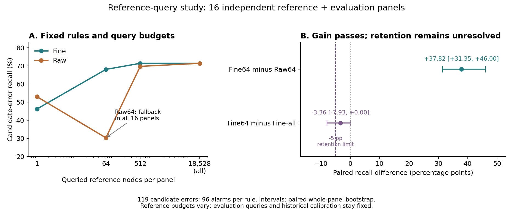

# 2026 年 11 月 11 日本机研究记录

当前研究问题为 When Does Factor Identifiability Yield Reliable Slow Representations? 本轮根据用户的持续自主推进授权，完成了当前主命题的本机理论审计、有限参考验证、实际 Fine 尺度归因、可见修复及独立面板查询预算检验。所有实验采用本机单线程 CPU，模型沿用缓存，无服务器、GPU 或新训练。论文草稿没有改动。

本轮最重要的更新是：**实际 Fine 的上一轮失败主要来自参考尺度错配，已有可见查询能修复它；Fine 在稀疏参考校准下有实测精度优势，但尚未通过保持全查询性能的预设门。** 因此，当前研究可保留条件理论与尺度恢复机制的贡献，不能把结果提升为一般 Fine 可靠性证书或已经验证完成的省查询方法。

| 问题 | 目前结论 | 可见信息与外部条件 | 证据 |
|---|---|---|---|
| 所有相容坐标是否同意慢集 | 总体二阶歧义与固定窗口一阶歧义可同时存在 | 精确剂量、已知参考、一轴单调相容类 | [原定理](dose_window_20261109/THEORY.md) |
| Gaussian 以外能否保留二阶 | 条件均值残差的折叠振幅给充要条件，可积导数给正例；有可逆反例 | 已知参考、光滑条件与有密度的有限路径 | [非 Gaussian](dose_nongaussian_20261110/THEORY.md) |
| 长窗口是否自动减少歧义 | 取决于总体竞争分数相对整段相容范围的位置；近并列的转折为 ℓ²√T | Gaussian、精确剂量、独立竞争轴 | [长窗口](dose_joint_window_20261110/RESULTS.md) |
| 有限参考是否改变目标判断 | 参考噪声可掩盖物理歧义；近并列尺度新增 4d²/N | 经验估计器分析用独立参考，物理目标保持总体归一化 | [有限参考](finite_reference_20261111/RESULTS.md) |
| 未知参考能否可靠作答 | DKW、尾界和全类分子区间得到非空保证；中等间隔长窗口覆盖 91.31% | iid 参考、外部尾包络、精确剂量、一轴相容类 | [有限参考定理](finite_reference_20261111/THEORY.md) |
| 有限带噪剂量能否确认窗口 | 同一候选约束联合处理分子分母提高约 31 个百分点覆盖 | 已知全局斜率盒、规定读数噪声、已知参考 | [联合校准](dose_stage1_20261110/RESULTS.md) |
| 实际 Fine 的上一轮失败来自哪里 | 同分母下换成真实分子也维持 56 命中，换物理分母后原重建分子达到 88 | 旧 384 窗口，真值仅作事后归因 | [分母诊断](fine_denominator_audit_20261111/RESULTS.md) |
| 可见查询能否修复 Fine 参考尺度 | 独立前瞻验证通过，图尺度 Fine 与同信息 raw 均命中 92，固定仿射 78 | 命名配对位移、冻结读出、可见参考点图；16 评价组共享一份参考 | [结果](fine_reference_graph_20261111/RESULTS.md) |
| 稀疏参考是否保留 Fine 独立收益 | 64 点 Fine 命中 81、raw 36，收益门通过；相对全查询的非劣门未建立 | 16 份独立参考及配套评价，64 为唯一主预算，包含固定回退 | [结果](fine_reference_query_budget_20261111/RESULTS.md) |
| 稀疏差异是否只是图门造成 | Fine64 尺度误差在 16/16 组更小；raw64 全回退又放大了报警差距 | 原查询重放；被拒绝解仅作揭盲后尺度诊断，未产生新预测 | [尺度核对](fine_reference_query_budget_20261111/rejected_scale_audit/REPORT.md) |

独立复核支持当前 Gaussian 联合极限、非 Gaussian 折叠判据和 Stage 1 联合外界的核心推导。原始 DMR 定理给有限样本均值界，当前函数类的条件与常数可对公度统一。有限概率界中的未显式常数、LP 外层固定数值余量及各实验适用条件仍按具体报告标注。 [审计](local_audit_20261111/THEORY_AUDIT.md)

近邻复核将理论增量定位到具体相容类、窗口排序概率和可计算作答范围。指数 ℓ^-4 本身来自标准尺度平衡；完整类端点的一致控制及正间隔下的同观测相反答案承担主要内容。 [近邻对照](local_audit_20261111/NOVELTY_AND_GAPS.md)

有限参考验证分清了两个目标。在已知 Gaussian 参考律的模型里，有限样本分母造成的是指定估计器的误差；方差本来可以积分计算。未知参考定理另使用 iid 参考点与外部尾包络，提供全相容类同时有效的方差界。在中等间隔、65,536 个参考点、16,385 状态窗口下，观察到 91.31% 的可靠作答覆盖。这个非空保证依赖明确的模型和尾条件，实际 Fine 尚未满足同一套全部前提。

旧局部校正规则的失败解释已更新。旧 384 个窗口中，真实分子配旧分母仍命中 56，原估计分子配物理分母达到 88。这是事后归因。随后新参考与新评价数据上，只用可见响应的图尺度修复达到 92，超过仿射对照 78；同查询 raw 也达到 92。这是独立前瞻验证。原封存报告保留，并增加[后续说明](fine_local_dose_window_20261110/FOLLOWUP_20261111.md)，避免旧的收尾判断被当作最终机制结论。

稀疏查询试验有 16 个独立的参考与评价面板，每组 96 条参考、128 条评价，预先筛选 24 个窗口并报警 6 个。384 个候选中有 119 个原生 Fine 错例。全部规则评价同一原生 Fine 选集的对错，raw 的结果因此衡量同目标诊断能力。

| 参考查询节点 / 每组 | Fine 命中 / 96 报警 | raw 命中 / 96 报警 | Fine / raw 图失败组数 |
|---|---:|---:|---:|
| 1 | 55 | 63 | 0 / 0 |
| **64，预设主预算** | **81** | **36** | **0 / 16** |
| 512，辅助预算 | 85 | 83 | 0 / 0 |
| 全部 18,528 | 85 | 85 | 0 / 0 |

64 点 Fine 相对 raw 的候选召回提高 **37.82 个百分点，95% 区间 [31.35, 46.00]**。Fine64 相对 Fine 全查询的差为 **−3.36 个百分点，区间 [−7.93, 0]**；下端未超过预设 −5 个百分点，所以两条件的联合通过门未过。它没有证明实际损失一定超过 5 个百分点。512 点结果保留为辅助证据，不替代主预算，也不据此改写成功标准。

图自洽检查和物理精度需要分开。raw64 全部触发 2% 图残差门并回退，报警收益含有这条回退规则的影响。对原查询响应的事后重放显示，被拒绝 raw64 解的参考尺度平均相对绝对误差为 **1.21%**，Fine64 为 **0.39%**，16 组中 Fine 都更准。这支持当前固定估计器的尺度精度差异。它没有衡量取消回退后的新报警性能，也没有证明 raw 在相同信息下无法达到 Fine 精度。

Fine64 的净损失发生在三个面板：少 1、1、2 个命中；对应最大逐轴尺度误差为 0.81%、1.34%、1.10%。三个漏报的估计间隔变号，另一个仍为负但未进入六条报警。评价分子固定，差异只来自参考分母。即使图残差门通过，尺度误差仍须和具体窗口的排序间隔共同判断。 [净损失核对](fine_reference_query_budget_20261111/RETENTION_DIAGNOSTIC.md)

查询成本也按范围记录。64 点使用 512 次参考分支读出，评价仍需 37,056 次，共 37,568 次/面板；全参考为 185,280 次/面板。这些是历史轴对应和剂量仿射映射固定之后的新增成本，已有校准和训练不计入。图修复依赖已知命名物理轴、剂量及配对响应，不能直接外推到只有被动视频的部署条件。

当前可以承担论文主线的是：完整相容类如何影响逐窗口慢集；总体、有限窗口与有限参考为何有不同可靠边界；在明示结构与尾条件下怎样得到可观测的非空作答；实际尺度恢复如何兑现或破坏这些机制。Fine 的稀疏优势是特定冻结模型与规则上的有限证据。未知参考置信界、图积分条件界和实际 Fine 经验结果之间的假设差异保留在报告中。

本轮已达到当前主张的本机闭合点。预定的跨 checkpoint 迁移以两项主门同时通过为触发条件，本轮未触发；没有补样本、挑选辅助预算或放宽阈值。后续若重新开展方法研究，需要先提出新的可观测误差控制或查询规则及独立验证协议；目前不据此启动训练。更高维、更多未知轴和其他观测接口仍可形成新课题，不计作当前已验证结论。 [闭合审计](local_audit_20261111/LOCAL_CLOSURE_AUDIT.md) · [信息边界审计](fine_reference_query_budget_20261111/CODE_AUDIT.md)
