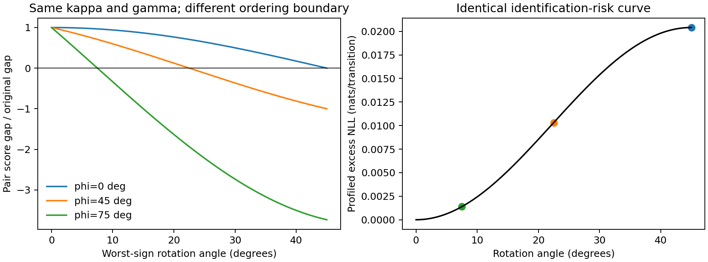

# HCF-JEPA Stage A+ 交付导航

2026年11月4日第一轮交付。论文问题：**When Does Factor Identifiability Yield Reliable Slow Representations?** 当前固定方法为 Conditional-Density Fine＋Deterministic G0＋Full-Fine C1L。

**研究决定：CONDITIONAL GO，继续聚焦机制研究；4090正式实验的科学门槛尚未通过。** 本轮完成新增证明、近邻全文复核和既有数组的只读诊断，没有训练、修改正式模型、调整评价门或启动服务器任务。

## 从这里阅读

| 文件 | 解决的问题 |
| --- | --- |
| [DECISION.md](DECISION.md) | 当前状态、新发现、贡献候选、GPU准入与下一步判断 |
| [THEORY.md](THEORY.md) | 三条路线取舍、κ定义、二维精确风险边界、合法动态反例与适用范围 |
| [NOVELTY.md](NOVELTY.md) | 哪些是已有理论、哪些是本项目新增、哪些还不能称论文创新 |
| [EVIDENCE_GAPS.md](EVIDENCE_GAPS.md) | 未解决的实际Fine连接、无标签认证、总体排序及独立方法价值 |
| [MIGRATION_READINESS.md](MIGRATION_READINESS.md) | 已核实的本地来源、checkpoint盘点及尚未执行的迁移工作 |

## 本轮最重要的新增结果

在明确的二维剩余旋转族中，辨识风险到指定物理目标排序的精确边界还取决于状态与增量的交叉矩。三个合法条件高斯动态系统保持整个辨识风险函数及物理速度间隔相同，临界角却为45°、22.5°、7.5°。这证明κ和γ不能唯一决定该族的精确边界；不排除依赖额外矩界的保守充分条件，也不自动认证实际四维非线性Fine。

FHN旧范数充分界覆盖0/6父模型；保留真实交叉矩的成对界覆盖6/6，全部四槽为12/12父、48/48对。该收紧定位了旧界的松弛，但需要真值，是同TRAIN上的事后科学诊断，**不是无标签或总体概率证书**。旧Oracle错选、weak失败与raw G4成功均保留。

## 证明、原始复算与来源

| 附件 | 内容 |
| --- | --- |
| [KAPPA_THEORY.md](KAPPA_THEORY.md) | profiled风险、曲率、Fisher、一般维数受限误差界与有限样本困难下界 |
| [NEAREST_WORK_REVIEW.md](NEAREST_WORK_REVIEW.md) | FAR-JEPA、iVDFM、GIN、经典联合对角化、SOBI、ISFA/xSFA等正文条件与定理位置 |
| [PAIRED_SCORE_AUDIT.md](PAIRED_SCORE_AUDIT.md) | 全12父的成对误差分解、旧界对比、FHN示例与Oracle正反例 |
| [PAIRED_SCORE_AUDIT.json](PAIRED_SCORE_AUDIT.json) | 逐父、逐pair、逐h数值与输入文件哈希 |
| [ROTATION_GEOMETRY.json](ROTATION_GEOMETRY.json) | 四槽真值二阶矩及假设性二维旋转诊断；不是对实际Fine拟合 |
| [ANALYTIC_BRIDGE_CHECKS.json](ANALYTIC_BRIDGE_CHECKS.json) | 三个合法动态反例的矩阵、风险阈值及公式残差 |
| [KAPPA_FORMULA_CHECKS.json](KAPPA_FORMULA_CHECKS.json) | rich/weak曲率与风险公式、固定矩阵不等式核验 |
| [CONTEXT_INTEGRITY.json](CONTEXT_INTEGRITY.json) | 189个冻结源、Stage A输入、Git及本机信息 |
| [CHECKPOINT_INVENTORY.json](CHECKPOINT_INVENTORY.json) | 12份Fine_latest与metadata字节哈希；未反序列化或独立验证内部选点状态 |
| [DELIVERY_CHECKS.json](DELIVERY_CHECKS.json) | 交付结构、链接、公式记录、输入完整性与范围检查 |
| [SHA256SUMS](SHA256SUMS) | 本目录交付文件的SHA256清单，自身除外 |

复算代码为[analytic_bridge_checks.py](analytic_bridge_checks.py)、[kappa_formula_checks.py](kappa_formula_checks.py)与[paired_score_audit.py](paired_score_audit.py)。前两项仅做确定性公式/矩阵计算，第三项只读现有TRAIN及冻结CAL映射；均不调用模型。复算输出写入本目录，不覆盖历史实验目录。复算代码的存在和公式检查通过均不等于实际学习器获得理论保证。

## 接续边界

首选下一步是把受限旋转结果扩展至有明确余项控制的误差类，并判断它能否对独立实例产生新的失败预测；同时确定Fine相对raw同规则分析的一项可检验增量。若结果仅停留在二维恒等式、经典曲率和有真值事后界，应停止把固定模块组合作为强方法创新扩张，不能用扩大baseline训练补足创新。

已有[Stage A报告](../../outputs/HCF_STAGE_A_20261104/HCF-JEPA_Stage_A_科学问题与理论可行性报告.md)仍是问题定义和历史证据入口。本目录只增加A+分析；未覆盖历史数据、源码、checkpoint或报告。服务器迁移、CUDA一致性与正式baseline均尚未执行。
