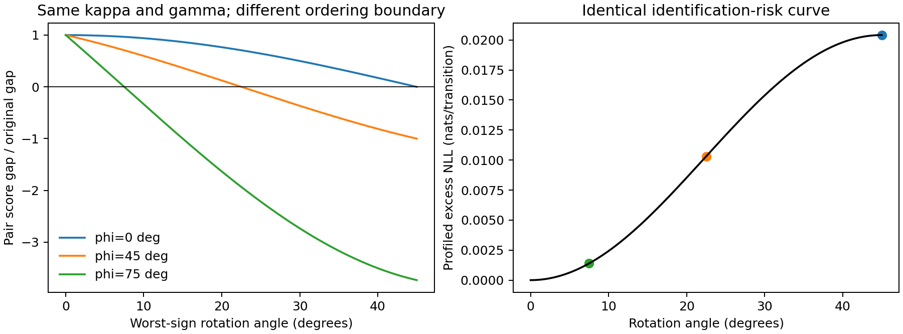

# HCF-JEPA Stage A+ 核心理论选择与新增结论

日期：2026年11月4日。承接[Stage A](../../outputs/HCF_STAGE_A_20261104/HCF-JEPA_Stage_A_科学问题与理论可行性报告.md)，固定 Conditional-Density Fine＋G0＋Full-Fine C1L。本轮没有训练、改模型、生成新物理轨迹或启动GPU。

**本轮选定的优先路线：受限剩余坐标误差下，辨识风险如何改变指定物理目标的速度差。** 新的严格结果是一个二维精确风险边界及可实现的反例：即使整个辨识风险函数与物理速度间隔γ都相同，选择鲁棒边界仍可不同。它还依赖状态与增量的交叉矩几何。该结果有明确数学内容，但相对经典联合对角化与SFA的论文级新颖性尚未确认，不能据此给正式GPU实验GO。

## 1 三条路线的取舍

| 路线 | 本轮实际完成 | 判断 |
| --- | --- | --- |
| R1 κ→轴误差→指定目标速度差，保留动态相关几何 | Gaussian风险/曲率、二维精确边界、同κ同γ反例、FHN相关矩诊断 | **首选，条件继续**；假设窄但可证伪，仍需实际Fine的remainder与独立科学预测 |
| R2 同签名块的部分辨识与目标群不变性 | 明确全轴、目标子空间与块内歧义不同 | 已有块辨识/FAR理论重合强；保留边界，不降低四轴标准 |
| R3 Fine相对raw同规则分析的独立增量 | 核对已有raw成功；给非线性表示相对raw线性类的表达能力反例 | 表达能力不等于Fine学习成功；现有证据没有证明该组件不可替代 |

## 2 κ的严格对象与坐标规范

先固定物理逐轴尺度H=diag(b_j)，v=H^−1(s−常数)。为连接G0，本报告取b_j=√Var_Q0(s_j)，即在预先固定Q0上将真实物理状态逐轴标准化。它只使state covariance的对角线为1，不使因素互不相关。创新方差在同一坐标下写为d_j(u)=D_jj(u)/b_j²。

以下从**强受限假设**出发：候选相对于真inverse仅剩v→Qv，Q为正交矩阵；dense条件均值可精确吸收该变换，每regime的最佳对角方差可自由profile，Jacobian绝对行列式为1。实际Fine的非线性flow并没有被证明属于此类；逐轴standardization、dense4高R²也不推出orthogonal gauge。

定义pair的局部风险曲率

\[
\kappa_{ij,H}=E_u\frac{(d_i(u)-d_j(u))^2}{d_i(u)d_j(u)}.
\]

单位为每transition的角度风险曲率（角度以radian计）。它不是任意自然参数对比矩阵的最小奇异值，也不是神经因素误差。rank矩阵的取点、条件概率、变量/统计量缩放会改变其奇异值；该风险量还依赖这里固定的H和正交角度类。全轴可用κ_all=min_i<j κ_ij，跨目标边界可用κ_cross=min_i∈S*,j∉S* κ_ij；后者即使为正也不保证块内各轴恢复，不能替换原联合门。

另定义全角域barrier B_ij=F_ij(1)，其单位为nats/transition。**κ_curv、B_barrier、σ_min(natural contrast)、实际轴误差四者分名。** reference-innovation whitening是另一种H，不能将其角度或旧AR曲率数值直接接到本报告state-normalized的γ、χ。

## 3 受限风险到因素角度

**Proved under stated restricted model。** 两轴旋转取

\[
Q_\theta=\begin{pmatrix}\cos\theta&\sin\theta\\-\sin\theta&\cos\theta\end{pmatrix},
\quad |\theta|\le\pi/4,
\quad z=\sin^2(2\theta).
\]

局部支相对于正确signed-permutation对齐固定。正交表示的最优对角Gaussian近似方差为diag(QD_uQᵀ)。因此总体profiled observation NLL excess为

\[
\boxed{F_{ij}(z)=\tfrac12E_u\log(1+a_u z),\qquad
 a_u=\frac{(d_i-d_j)^2}{4d_id_j}.}
\tag{T1}
\]

证明：旋转后对角元乘积=d_i d_j+(d_i−d_j)²sin²θcos²θ，行列式仍d_i d_j；Gaussian KL的最佳对角拟合为½log(对角元乘积/行列式)，再平均u。

若P(a_u>0)>0，F严格递增，给精确风险反演z≤F^−1(r)。log凹性又给

\[
B_{ij}z\le F(z)\le\kappa_{ij,H}z/8,
\quad F(Q_\theta)=\tfrac12\kappa_{ij,H}\theta^2+o(\theta^2).
\tag{T2}
\]

证明：F(0)=0，凹函数在[0,1]上不低于端点连线；log(1+x)≤x给上界；z=4θ²+o(θ²)给曲率。

一般d的受限非渐近界、Fisher nuisance正交计算与有限样本困难下界见[KAPPA_THEORY](KAPPA_THEORY.md)。其中variance在[m,M]、R=M/m、κ_all>0时，有

\[
F(Q)\ge\frac{\kappa_{\rm all}}{16R^2}
\min_{P\in\mathrm{signed\ permutation}}\|Q-P\|_F^2.
\]

证明来自log强凹性、orthostochastic混合权重与匹配；它是经典Gaussian联合对角化的受限推论，不是任意flow的NLL-to-axis定理。

## 4 核心桥：风险到指定两轴排序的精确边界

按同一Q0真状态标准化，记

\[
\Sigma=\begin{pmatrix}1&\rho\\\rho&1\end{pmatrix},\quad |\rho|<1,
\qquad
M=\frac1{|\mathcal H|}\sum_h E_{Q_h}[\Delta_hv\,\Delta_hv^T]
=\begin{pmatrix}S_1&C_\Delta\\C_\Delta&S_2\end{pmatrix}.
\]

M是增量的**二阶矩**，不要求增量均值为零；不同h允许不同合法端点Qh。声明物理目标为轴1且γ=S2−S1>0。定义

\[
\chi=2C_\Delta-\rho(S_1+S_2).
\]

χ是归一化Rayleigh商的方向敏感性组合，不将它声称为新的基本统计概念。

### T3 精确Pair-Gap Identity

**Proved。** 旋转后按各自真实state方差重新标准化，速度差为

\[
\boxed{g(\theta)=S_2^{Q}-S_1^{Q}
=\frac{\gamma\cos2\theta-\chi\sin2\theta}
{1-\rho^2\sin^2 2\theta}.}
\tag{T3}
\]

**证明。** 令t=sin2θ。两坐标方差分别为1+ρt、1−ρt；增量分子分别为N1=S1cos²θ+S2sin²θ+CΔt和N2=S1sin²θ+S2cos²θ−CΔt。相减两个比值，公分母为1−ρ²t²；分子为N2−N1+ρt(N2+N1)=γcos2θ−[2CΔ−ρ(S1+S2)]t。证毕。没有使用平稳或独立因素假设。

因此g'(0)=−2χ。χ≠0时pair-gap可一阶退化；χ=0时pair-gap的一阶项抵消。**后者不意味着每个单轴score都没有一阶误差**：当ρ≠0、χ=0时，两个单轴score的一阶偏移可以相同而在差中抵消。

### T4 Sharp Population Risk Barrier

**Proved；仅上述二维旋转族，并沿用P(a_u>0)>0（即B_ij>0）的非退化条件。** 令

\[
z_* =\frac{\gamma^2}{\gamma^2+\chi^2},\qquad
r_* = F_{ij}(z_*).
\tag{T4}
\]

当χ=0时z*=1。对风险球{θ:|θ|≤π/4,F(sin²2θ)≤r}内的**全部角度符号**，两轴严格保持原物理排序的必要且充分条件为

\[
\boxed{r<r_*.}
\]

**证明。** 分母恒正；固定z时最不利符号使分子=γ√(1−z)−|χ|√z。该量在z∈[0,1]单调下降，首次为零恰在z=z*。F严格递增，所以r<r*使全部可行z<z*；r≥r*允许取临界角形成tie。χ≠0且r>r*还允许反序。χ=0时在canonical端点形成tie，不声称域内必有反序。证毕。

这比γ>常数×√(r/κ)更具体：当χ=0，无统计score误差时，pair排序到45°之前保持；当|χ|/γ大，允许的风险可能远小于45°barrier。它仍是受限模型下的精确几何结论，不能当作实际4D非线性Fine的认证。

### T5 有统计评分误差时的条件性保证

**Conditional，代数Proved。** 若同一目标口径下两轴经验score各有误差≤ε_score，r<B，令z̄=F^−1(r)，则

\[
\gamma\sqrt{1-\bar z}>|\chi|\sqrt{\bar z}+2\varepsilon_{\rm score}
\tag{T5}
\]

保证pair正确。因为分母≤1，分子大于2ε即足够；更紧的单角度条件保留2ε(1−ρ²z)。可用z̄≤r/B获得更保守显式式，但不用近似量替换F宣称sharp。

若Q̂对同一受限empirical profiled objective是全局o_opt-近最优（真θ=0为可行比较器），且在一个概率≥1−δ_L的事件上sup_Q|Ĵ(Q)−J(Q)|≤ε_L，则总体r=2ε_L+o_opt有效；再与评分误差事件失败率δ_S合成，T5以至少1−δ_L−δ_S成立。这是**以风险事件为条件**的有限样本结论，不是已证明当前Fine满足该uniform事件。用同TRAIN选择Fine时不能将其条件冻结后当固定函数套集中；可沿用Stage A的逐样本oracle分解。

真正的四轴语义Reliability还需原axis gate，及全部target/non-target比较和稳定性事件；T3–T5只处理一对轴。即使其他轴固定，两个受旋转坐标与其他轴的比较也须检查，不能把pair临界角叫全选集鲁棒半径。

## 5 同κ、同γ仍有不同边界的合法动态构造

**Proved；解析反例，不是新增HCF实验。** 固定H={4,16,32}，r=.6，d=.1，τ=.2。外生regime u=±等概率，独立Gaussian创新

\[
D_\pm=d\,\mathrm{diag}(1\pm\tau,1\mp\tau).
\]

取外生已知动作a_t~N(0,I)，构造

\[
N_\phi=\begin{pmatrix}\cos\phi&\sin\phi\\\sin\phi&-\cos\phi\end{pmatrix},
\quad A_\phi=rI+\eta_\phi N_\phi,
\quad s_{t+1}=A_\phi s_t+B_\phi a_t+\epsilon_t,
\]

其中Bφ Bφᵀ=I−Aφ Aφᵀ−dI正定，ηφ∈(0,.3)。A稳定；u、a外生；所以平稳state covariance恰为I，满足G0的state-unitvariance gauge。边际state一般不是Gaussian，**一步条件律是精确Gaussian**，足以满足本受限理论。

记Cη=平均_h[(r+η)^h−(r−η)^h]。因Nφ²=I，M=mI−CηNφ。于是γ=2Cηcosφ，χ=−2Cηsinφ。取固定γ=.01，令Cη=γ/(2cosφ)，在φ=0°、45°、75°都存在唯一η<.3，且B协方差保持正定。

这三个系统具有**完全相同的D、κ_curv、B_barrier和整个F(z)**，以及相同γ；只有动态几何χ不同。

| φ | γ | χ绝对值/γ | κ_curv | B_barrier | 最坏符号pair临界角 | sharp r* |
| --- | ---: | ---: | ---: | ---: | ---: | ---: |
| 0° | .01 | 0 | .16666667 | .02041100 | 45° | .02041100 |
| 45° | .01 | 1 | .16666667 | .02041100 | 22.5° | .01030964 |
| 75° | .01 | 3.73205081 | .16666667 | .02041100 | 7.5° | .00139362 |

所以κ、γ不唯一决定sharp failure boundary；连整个F固定后仍需χ。**这不排除仅用κ、γ加全局矩界给出保守充分条件**，也不声称推翻所有两参数定理。

[确定性矩阵核验](ANALYTIC_BRIDGE_CHECKS.json)检查stationary covariance、B正定、每h矩阵幂与T3，最大公式残差8.89×10^−16；没有抽取随机数据、训练或拟合神经网络。η的求解是实现解析反例的单变量确定性求根，不是HCF超参搜索。加入独立且score远离该pair的固定慢/快因素可嵌入四维选择例；本表自身只作为二维机制证明。

## 6 FHN证书为什么松，以及本轮实际解决了什么

已有TRAIN上的Fine与真因素分别标准化并以原CAL映射对齐，写X_jh=Δ_hU_j，E_jh=Δ_h(W_j−U_j)。定义c_jh=平均(X_jhE_jh)、r_jh=平均E_jh²。对目标a与非目标b，实际pair-gap误差精确为

\[
D_{ab}=2\overline{c_{bh}-c_{ah}}+\overline{r_{bh}-r_{ah}}.
\]

普通三角不等式给真值辅助界

\[
B^{corr}_{ab}=2|\overline{c_{bh}-c_{ah}}|+
|\overline{r_{bh}-r_{ah}}|.
\]

若每对物理gap大于该界与数值舍入allowance之和，则当前有限数组选集正确。只控不利方向还可更紧。该代数不是新理论，**c/r需真实U，是有标签事后科学诊断**。

[完整12父复算](PAIRED_SCORE_AUDIT.md)得到：旧全局Cauchy为6/12，pair-specific与极化Cauchy仍6/12；保留实际signed cross-moment的合法界为12/12，48/48 pair。FHN覆盖从0/6到6/6。主要原因是实际cross-moment远低于Cauchy最坏对齐，**不保留跨h抵消的相关矩界也已12/12**，故不能把全部改善归功多h抵消。新界有10/48格退化为exact绝对误差，更不能将覆盖提高称为独立新泛化证据。

这解决了“是否只能靠极松范数预算解释已有成功”的问题；没有解决无标签可计算、总体高概率或重新训练Fine后的认证。旧FHN t≥11物理oracle负gap仍失败，即使令W=U、误差界为零也无法救回。

同一物理TRAIN的[假想旋转几何](ROTATION_GEOMETRY.json)显示AR的|χ|/γ约.002–.046，FHN ε=.08约.245–.355，ε=.5约.261–.881；后者(1,2) pair临界角约24.32°。这些是已暴露数组的二阶矩敏感性，**未拟合实际Fine为正交旋转**，也没有将旧AR raw-gauge风险数值混入FHN证书。

## 7 为什么Fine可能有用，以及目前不能声称什么

**受限表达能力反例，Proved。** 若独立标准Gaussian物理因素s1,s2经可逆shear x1=s1、x2=s2+αs1²观测，任何从raw x的稠密线性读出恢复s2的最佳R²为1/(1+2α²)。证明：中心化x2=s2+α(s1²−1)，后一项与s1和s2均不相关；x1不能在线性类中消除该噪声。任何可逆闭式线性动态后处理＋scalar-affine读出仍在这个类。理想非线性inverse s2=x2−αx1²则精确恢复。

它说明非线性表示/非线性读出可有独立价值，但**不证明Fine训练能学到该inverse，不证明任意非线性baseline不能做到，也不证明当前有限flow精确包含这个多项式inverse**。当前raw G4在已有AR与强观测干预中都过门，因此没有已建立的“Fine不可替代组件”。C1L小幅预测收益不补这一缺口。

## 8 完成与开放的边界

**Proved：** 受限Gaussian风险到角度；同一gauge中的风险到pair排序精确边界；合法conditional Gaussian VAR中同κ同γ不同χ；当前有限数组相关矩margin界；非线性inverse相对raw线性类的表达能力反例。

**Conditional：** 经验受限risk事件→角度→排序的概率链；全d正交误差界；将这些用于某个训练器时的假设包含性。

**Unresolved：** 当前非线性Fine是否接近这个剩余旋转类、其nonlinear remainder如何控制signed score误差、CAL NLL到总体risk的界、实际无标签物理目标认证、独立实例上的边界预测以及充分的新颖性。

本轮没有把任何一项Unresolved当作已完成。核心新增结论适合作为精确机制候选；它还不足以证明当前HCF固定组合具备ICML方法创新。
