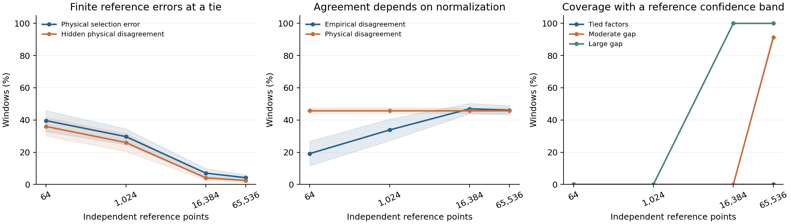

# 有限参考数据会改变候选一致性和物理慢集

四项预设机制及覆盖门全部通过。在最长窗口的并列组，64 个参考点使恒等读出的物理错选率达到 39.60%。增到 65,536 个参考点后，该值降到 4.20%。同一批窗口中，两个相容物理解释有 45.80% 选出不同慢集，而 64 个参考点下，采用经验分母的两个解释只有 19.14% 显示分歧。参考噪声会掩盖原本存在的物理分歧。 [冻结协议](PROTOCOL.md) · [理论与未知参考置信界](THEORY.md)

正式使用 32 个独立面板，各含 64 条评价轨迹，共 2,048 条。每个面板共享一份独立参考，所有统计区间按整个面板配对重抽样。参考预算嵌套，短窗口取长轨迹前缀。主目标始终按真实总体方差定义。经验归一化用于衡量指定估计器，安全作答使用仅依赖参考样本、剂量和外部尾界的区间。

| 并列组，16,385 状态 | 64 参考 | 1,024 参考 | 16,384 参考 | 65,536 参考 |
|---|---:|---:|---:|---:|
| 恒等经验读出的物理错选率 | 39.60% | 29.69% | 6.98% | 4.20% |
| 两套经验解释的分歧率 | 19.14% | 33.84% | 46.92% | 46.09% |
| 经验一致掩盖物理分歧 | 35.99% | 26.03% | 4.00% | 2.44% |
| 经验一致且至少一套答案错误 | 50.29% | 27.88% | 4.00% | 2.44% |

表中后三行以全部窗口为分母。第一种掩盖事件要求物理解释确实相反，第二种错误一致事件也包括物理解释本来同意、但经验共同答案错误的窗口。

恒等物理错选从最小到最大参考预算下降 35.40 个百分点，配对 95% 区间 [28.86,41.55]。经验分歧随参考预算增加 26.95 个百分点，区间 [18.80,35.45]。最小预算下的掩盖物理分歧率为 35.99%，区间 [30.13,41.44]。这些结果符合有限参考共同误差在长窗口下仍保留的预测。

理论给出近并列间隔的尺度

\[
s_{T,N}^2=\sigma_w^2/T+4d^2/N.
\]

采用经验分母的相容类转折由 \(\ell^2/s_{T,N}\) 决定。相对真实总体归一化目标，恒等解释的极限错选概率为

\[
\frac1\pi\arccos\left(\frac{\sigma_w}{\sqrt{\sigma_w^2+4d^2T/N}}\right).
\]

该公式取 \(T,N\) 同时增长。在当前参数和最大参考预算，它给约 4.2%，与本轮读数接近。固定参考量时继续拉长评价窗口，参考误差不会由评价轨迹的增加自动消失。

## 保持总体物理目标的作答区间

可观测规则给参考 CDF 构造 DKW 带，并用已知尾概率包络控制截断外能量。方差带同时覆盖整个单调相容类。窗口增量使用相位线性极值及阈值二次项上界。规则仅在选中轴的最高上界低于其余轴的最低下界时作答。

| 最长窗口的安全作答率 | 64 参考 | 1,024 参考 | 16,384 参考 | 65,536 参考 | 已知参考规则 |
|---|---:|---:|---:|---:|---:|
| 总体并列 | 0% | 0% | 0% | 0% | 23.93% |
| 中等正间隔，第二轴 .99 | 0% | 0% | 0% | 91.31% | 93.21% |
| 大正间隔，第二轴 .97 | 0% | 0% | 100% | 100% | 100% |

四轴参考带合并后的置信事件至少为 99%，按每个预算单独成立。同一事件覆盖该面板全部窗口与全部候选解释。正式未观察到参考带漏掉两套指定真值，安全作答对两套真值的错误均为零。参考真值核验只有预先指定的两套解释，整类覆盖来自解析推导。

并列组的全拒答说明当前未知参考外界仍有明显保守性。中等正间隔在有限预算已能给出非空且较高的作答覆盖。大间隔 .97 是运行前依据区间宽度增加的检验条件，保留 .99 作为前轮可比条件。100% 是本轮样本覆盖读数，表中置信区间若退化也不代表所有未来样本都能作答。 [完整计数和配对区间](SUMMARY.json)

原已知 Gaussian 参考律允许直接积分。有限参考错选的读数描述经验归一化估计器。未知参考置信保证使用额外明确提供的正态尾包络、iid 参考点、精确剂量和一轴相容类。在这些前提下，评价数据增加、参考数据增加和相容坐标范围缩小分别影响可靠性的不同部分。

图中阴影为整面板重采样的描述性 95% 区间。
